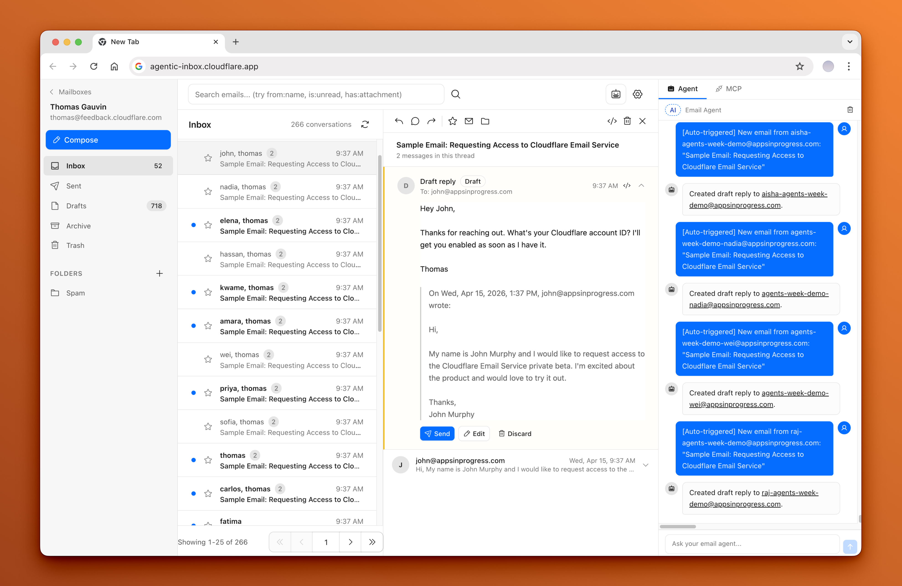

# Flarebox

Self-hosted email client with an AI agent. Runs on Cloudflare Workers, Durable Objects, R2, and Email Routing.

Fork of Cloudflare's [Agentic Inbox](https://github.com/cloudflare/agentic-inbox). Apache 2.0.



---

## Features

From upstream:

- Send and receive mail, threads, folders, attachments, rich text editor
- One Durable Object (SQLite) per mailbox, attachments in R2
- AI agent side panel: read, search, draft
- MCP server at `/mcp`

Added in Flarebox:

| Area | What |
| --- | --- |
| Inbox | Combined inbox for all addresses, bulk actions, empty Junk |
| Search | `from:` `in:` `has:attachment` `after:` operators, filter panel, bookmarkable URLs |
| Mobile | Installable PWA, swipe between emails, dark mode |
| Notifications | Web Push for new mail, no third-party service |
| Accounts | Add domains, subdomains, and addresses from Settings, no redeploy |
| Routing | Auto-creates Email Routing rules (optional API token), catch-all, forwarding |
| Migration | Rename or merge addresses, export a mailbox as `.tar` |
| Spam | Built-in junk filter, block rules, "Not spam", optional Rspamd |
| AI | Pick any OpenRouter model in Settings, custom instructions per address, auto-drafts opt-in |

---

## Requirements

- Cloudflare account with a domain
- Cloudflare Access (Zero Trust)
- OpenRouter API key, only for the AI agent

---

## Deploy

### 1. Deploy the Worker

[](https://deploy.workers.cloudflare.com/?url=https://github.com/dalisys/flarebox)

Or from a clone:

```bash
npm install
npx wrangler r2 bucket create flarebox
npm run deploy
```

### 2. Add Cloudflare Access

Create a **hostname-based** Access application for the app's hostname. Worker-level Access breaks WebSockets.

```bash
npx wrangler secret put POLICY_AUD --name flarebox    # Access app audience tag
npx wrangler secret put TEAM_DOMAIN --name flarebox   # https://<team>.cloudflareaccess.com
```

The Worker rejects all requests until both are set.

### 3. Add the AI key (optional)

Skip this to run Flarebox as a plain email client. Without it, the app hides all AI features.

```bash
npx wrangler secret put OPENROUTER_API_KEY --name flarebox
```

### 4. Set up mail

- Receiving: turn on Email Routing for your domain and route addresses to the `flarebox` Worker.
- Sending: onboard the domain to [Email Sending](https://developers.cloudflare.com/email-service/get-started/).

Optional: add a [scoped API token](docs/setup.md#3-cloudflare-api-token-optional) and the app creates routing rules for you.

### 5. Open the app

Mailboxes in `EMAIL_ADDRESSES` are created on first load. Add more in **Settings → Accounts**.

---

## Configuration

| Name | Type | Required | Purpose |
| --- | --- | --- | --- |
| `POLICY_AUD` | secret | yes | Access audience tag |
| `TEAM_DOMAIN` | secret | yes | Access team URL |
| `OPENROUTER_API_KEY` | secret | no | AI agent and auto-drafts |
| `DOMAINS` | var | yes | Default email domains |
| `EMAIL_ADDRESSES` | var | no | Mailboxes created on first load |
| `OPENROUTER_MODEL` | var | no | Default `openai/gpt-4.1-mini` |
| `CATCH_ALL_MAILBOXES` | var | no | Domain → catch-all mailbox |
| `CLOUDFLARE_API_TOKEN` | secret | no | Manage Email Routing from the UI |
| `FORWARD_TO_EMAIL` | secret | no | Copy incoming mail to another address |
| `RSPAMD_*` | secret | no | Rspamd scanner, see [spam docs](docs/spam-filtering.md) |

Vars go in `wrangler.jsonc`. For your real values, copy it to `wrangler.local.jsonc` (git-ignored, used by builds when present).

---

## Development

```bash
cp .dev.vars.example .dev.vars
npm run dev
```

| Command | Does |
| --- | --- |
| `npm run typecheck` | Generate types and run `tsc` |
| `npm run build` | Production build |
| `npm run test:spam` | All tests (Node 22.13+) |
| `npm run test:search` | Search parser |
| `npm run test:email-cache` | Client cache |
| `npm run test:mailbox` | Mailbox export |
| `npm run test:push` | Web Push |

---

## Docs

- [Setup](docs/setup.md): Access, API token, sending, AI, custom hostname, troubleshooting
- [Accounts and domains](docs/accounts-and-domains.md): addresses, domains, subdomains, catch-all, forwarding, export
- [Inbox and search](docs/inbox-and-search.md): search operators, filters, push
- [Spam filtering](docs/spam-filtering.md): junk filter, Rspamd

---

## Security

Cloudflare Access is the only auth layer. Anyone who passes your Access policy can read every mailbox, change domain settings, and use `/mcp`. Keep the policy tight.

---

## Stack

React 19 · React Router 7 · Tailwind · TipTap · Hono · Workers · Durable Objects · R2 · Agents SDK · AI SDK · OpenRouter

## License

Apache 2.0. See [LICENSE](LICENSE).
