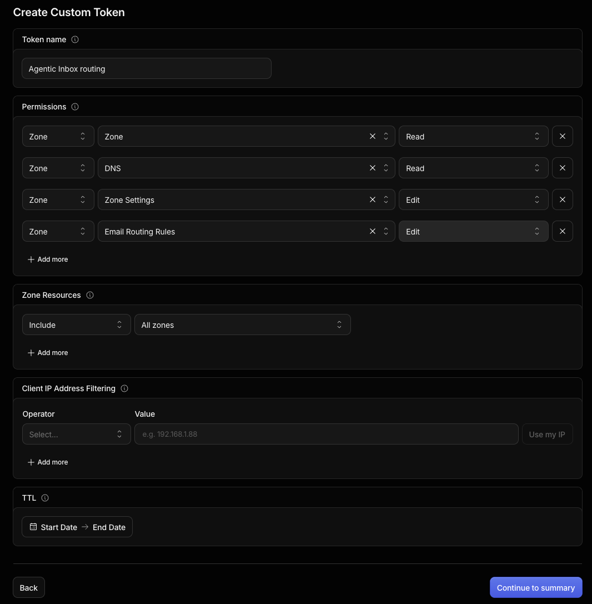

# Setup

The Deploy button is only the first step. Do the steps below too.

For a step-by-step guide with screenshots of the original project, see [this comment](https://github.com/cloudflare/agentic-inbox/issues/4#issuecomment-4269118513).

All `wrangler secret put` commands ask for the value at a prompt. Run them from this folder.

## 1. Cloudflare Access

Access is the login for the app. The Worker refuses all requests until it is set.

1. Go to **Zero Trust → Access → Applications**.
2. Create a [hostname-based Access application](https://developers.cloudflare.com/workers/configuration/cloudflare-access/#protect-a-specific-hostname-custom-domain-or-path) for the inbox hostname.
   - Do not use Worker-level Access. It blocks the WebSockets this app needs.
3. Save the two values as secrets:

   ```bash
   npx wrangler secret put POLICY_AUD --name flarebox
   npx wrangler secret put TEAM_DOMAIN --name flarebox
   ```

   - `POLICY_AUD` is the application's audience tag.
   - `TEAM_DOMAIN` is your team URL, for example `https://your-team.cloudflareaccess.com`.

## 2. Email Routing (receiving)

You have two choices:

- **Automatic:** create the [API token](#3-cloudflare-api-token-optional) below. The app then manages domains and address rules from **Settings**.
- **Manual:** in the Cloudflare dashboard, add a rule for each address: **Send to a Worker → flarebox**.

## 3. Cloudflare API token (optional)

With this token, the app can turn on Email Routing and create address rules for you.

1. Open [**My Profile → API Tokens**](https://dash.cloudflare.com/profile/api-tokens) **→ Create Token → Create Custom Token**. Name it `Flarebox routing`.
2. Add these **Zone** permissions ("Edit" means write access):

   | Permission | Access |
   | --- | --- |
   | Zone | Read |
   | DNS | Edit |
   | Zone Settings | Edit |
   | Email Routing Rules | Edit |

   

3. Under **Zone Resources**, pick **Include → Specific zone** for each domain.
   - **All zones** also works. It gives the token every current and future zone.
   - Leave **Client IP Address Filtering** empty.
   - Set a TTL only if you plan to rotate the token.
4. Select **Continue to summary → Create Token** and copy it. Cloudflare shows it only once.
5. Save it as a secret:

   ```bash
   npx wrangler secret put CLOUDFLARE_API_TOKEN --name flarebox
   ```

Notes:

- Never put the token in `wrangler.jsonc`, a commit, an issue, or a chat.
- For local development, put `CLOUDFLARE_API_TOKEN=...` in `.dev.vars`.
- Set `CLOUDFLARE_EMAIL_WORKER` only if your Worker is not named `flarebox`.
- Everyone who passes your Access policy can use the domain controls. Limit the policy to admins.
- Without the token, the app still creates domains and mailboxes. It shows that routing needs manual setup.

## 4. Email Sending

- The Worker sends mail with the `send_email` binding. See the [Email Service docs](https://developers.cloudflare.com/email-routing/email-workers/send-email-workers/).
- To send from a domain, [onboard that domain to Email Sending](https://developers.cloudflare.com/email-service/get-started/).
- Cloudflare Email Sending needs a paid Workers plan.

### Option: Resend (free tier)

Use [Resend](https://resend.com) to send mail without a paid Workers plan. Receiving still uses Cloudflare Email Routing (step 2).

1. Create a Resend account.
2. In Resend, add your sending domain. Add the DNS records that Resend shows to the domain in the Cloudflare dashboard. Wait until Resend shows the domain as verified.
3. In Resend, create an API key with **Sending access**.
4. Store the key as a Worker secret:

```bash
npx wrangler secret put RESEND_API_KEY --name flarebox
```

- When `RESEND_API_KEY` is set, all outgoing mail goes through Resend. Delete the secret to go back to Cloudflare Email Sending.
- **Settings → Domains** shows which provider is active. The app never shows or stores the key.
- For local development, put `RESEND_API_KEY=...` in `.dev.vars`.

## 5. AI (OpenRouter, optional)

The key is only for the AI agent and automatic drafts. Without it, email works normally and the app hides the agent panel and the AI settings.

```bash
npx wrangler secret put OPENROUTER_API_KEY --name flarebox
```

- Pick the model in **Settings → AI**. Type to search OpenRouter's model list, or paste any model ID. It applies to all accounts.
- `OPENROUTER_MODEL` in `wrangler.jsonc` is the default. **Reset** in Settings goes back to it.
- For local development, also put the key in `.dev.vars`.
- Never put the key in mailbox settings or `wrangler.jsonc`.

Each mailbox's **Settings** page has two switches. They save at once.

| Switch | Default | What it does |
| --- | --- | --- |
| **Enable AI assistant** | On | Off turns off chat and automatic drafts for this mailbox |
| **Create drafts when mail arrives** | Off | The agent drafts a reply to each new email. You can still ask for drafts in chat when this is off |

**Instructions** on the same page are used for every reply and email the AI writes from that address: chat, automatic drafts, and the write button. Use it for who you are, tone, language, sign-off, and facts. It is added to the built-in rules, so drafts stay drafts.

## 6. Custom hostname (optional)

To open the app on a hostname like `inbox.example.com`:

1. Add it as a [Worker Custom Domain](https://developers.cloudflare.com/workers/configuration/routing/custom-domains/) in **Worker → Settings → Domains & Routes**.
2. Add the hostname as another destination in your existing Access application. All hostnames must share one `POLICY_AUD`.

The app hostname and the email domains are set up separately.

## Config values

| Name | Where | What it is |
| --- | --- | --- |
| `DOMAINS` | `wrangler.jsonc` | Default email domains |
| `EMAIL_ADDRESSES` | `wrangler.jsonc` | Mailboxes created on first visit |
| `CATCH_ALL_MAILBOXES` | `wrangler.jsonc` | Domain → catch-all mailbox map |
| `OPENROUTER_MODEL` | `wrangler.jsonc` | AI model |
| `POLICY_AUD`, `TEAM_DOMAIN` | Secret | Cloudflare Access |
| `OPENROUTER_API_KEY` | Secret | Optional AI agent |
| `CLOUDFLARE_API_TOKEN` | Secret | Optional routing management |
| `FORWARD_TO_EMAIL` | Secret | Optional [forwarding](accounts-and-domains.md#forwarding) |
| `RSPAMD_*` | Secret | Optional [Rspamd](spam-filtering.md#rspamd) |

`.dev.vars` is for local development only. It does not change the deployed Worker.

## Troubleshooting

| Error | Cause | Fix |
| --- | --- | --- |
| `Invalid or expired Access token` | `POLICY_AUD` or `TEAM_DOMAIN` is wrong | Copy both again from the Access application and update the secrets |
| `Cloudflare Access must be configured in production` | Access is not set up. The app refuses to run open to the internet | Do [step 1](#1-cloudflare-access) |
